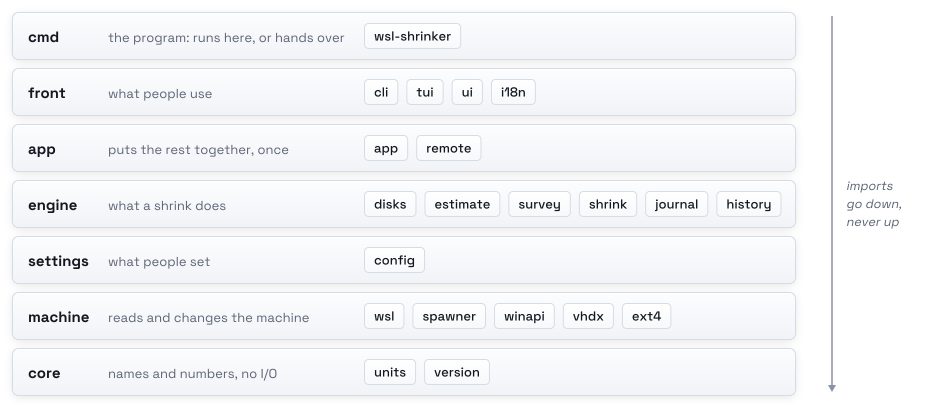

# Contributing to wsl-shrinker

wsl-shrinker changes disk files people cannot lose, so a change comes with a test showing it still refuses what it
should. Almost no work needs a real disk: the readers are tested on VHDX files and ext4 filesystems the tests build, a
shrink's steps on a fake WSL, and the screen on a made-up PC (`--demo`).

## How the pieces fit

The code under `internal/` sits in layers. Imports go down, never up; `internal/layers_test.go` fails when one goes up.

<picture>
  <source media="(prefers-color-scheme: dark)" srcset="../docs/assets/layers-dark.svg">
  
</picture>

| Layer | Packages | |
|:---|:---|:---|
| front | `cli`, `tui`, `ui`, `i18n` | the command line, the screen, colors and words |
| app | `app`, `app/remote` | puts the rest together for this PC; the screen's backend from WSL, over `wsl-shrinker.exe` |
| engine | `disks`, `estimate`, `survey`, `shrink`, `history`, `journal` | finding disks, what a shrink gives back, looking inside, a shrink's steps, past runs, the run in progress |
| settings | `config` | `config.toml` |
| machine | `vhdx`, `ext4`, `wsl`, `spawner`, `winapi` | reading disk files, talking to WSL, wsl-spawner and Windows |
| core | `units`, `version` | sizes as Windows shows them, with no I/O; the build's version |

`machine/vhdx` and `machine/ext4` only read, and refuse what they do not fully understand rather than guess. Only
`engine/survey` (cleaning) and `engine/shrink` (stopping and starting) build commands to run inside a distribution.
`shrink.Preflight` alone decides whether a disk can be shrunk now: the run's check, the screen, `doctor` and `shrink`
all ask it. The end of `shrink.Run` alone decides how a run left its distribution, in the result's `Left`; the fronts
read that, not the steps. [Internals](../docs/internals.md) has what runs where and why, and
[how it works](../docs/how-it-works.md) what a shrink does.

## Build and try it

You need Go (the version in `go.mod`; `go` fetches it if yours is older), shellcheck, e2fsprogs (`mkfs.ext4`,
`debugfs`, `dumpe2fs`) for the ext4 tests, Docker for the demo image, and a Windows PC with WSL to run it for real.
Development works from inside WSL:

```sh
git clone https://github.com/kanggu12/wsl-shrinker && cd wsl-shrinker
make build
dist/wsl-shrinker.exe list        # reads only
go run ./cmd/wsl-shrinker --demo  # the screen on a made-up PC, on any system
```

`list`, `inside`, `doctor` and the screen change nothing until you confirm a shrink. To try a shrink, shrink only a
throwaway distribution:

```sh
docker export "$(docker create alpine:3 true)" -o /tmp/alpine.tar
wsl.exe --import wss-test 'C:\wss-test' "$(wslpath -w /tmp/alpine.tar)" --version 2
dist/wsl-shrinker.exe shrink wss-test --yes
wsl.exe --unregister wss-test
```

## Run the tests

```sh
make check          # gofmt, go vet and staticcheck for Linux and Windows, shellcheck, go test -race ./...
make test-windows   # from WSL: every package's tests again as Windows programs
make fuzz           # the VHDX and ext4 readers, 30s each; a failing input lands in testdata/fuzz
make vuln           # govulncheck, for Linux and Windows
make demo           # the demo image from the work tree, opened in this terminal
```

A screen test renders every view at widths from 40 to 200 columns, in English and Korean, and fails if any line is not
exactly the screen's width. `--snapshot 120x30 --keys "c space enter"` prints one frame of the demo,
`setup --snapshot 100x30` the setup screen, and `--snapshot 100x24 --cli` CLI mode's disks.

A few tests hold what is hardest to see go wrong:

- `TestRecoveryMatrix` (engine/shrink): for every point a run can fail at, on every kind of disk, whether the
  distribution and its containers run afterwards. A change to failure handling must keep its table.
- `TestScreenInAConsole` (cmd/wsl-shrinker, Windows): the program in a pseudoconsole, the headless console behind a
  terminal tab, so no window opens. The screen draws, redraws on resize, and `q` ends it. Beside it, setup takes keys
  there and writes its file, and a mistake shows in color with what to do.
- `recorded_test.go` (machine/wsl): wsl.exe's own output, recorded once with made-up distribution names, through the
  parsing. Record a new wsl.exe's output there when its format changes.

No test opens a window. `winapi.Reopen` refuses inside a test binary. A test that runs a whole command sets the App's
`TerminalIn`, since a test binary started from WSL looks started from inside a distribution. A test in the cli package
that needs a terminal replaces `stdinIsTerminal` and `stdoutIsTerminal`, and the screens it would open (`openScreen`,
`openSetup`). The launcher's tests replace what it reaches Windows through (`locate`, `execve`, `openRemote`,
`runChild`, `exit`) and the PC's processor and Windows build (`hostMachine`, `windowsBuild`), so no test starts
`cmd.exe`. They give it only fake programs without the execute bit: a real one built for another processor would put
Windows' dialog on the desktop.

## Make a change

- **A new cache or download to clean**: add it to `caches` in `internal/engine/survey/survey.go`, with its kind
  (rebuilt on its own, or downloaded again), a word for it in both catalogs (`what.<name>`), and a line in the test's
  sample output. `TestNoCommandTouchesWhatMustStay` must keep passing.
- **Words on the screen**: every word goes through `i18n.T`, in `internal/front/i18n/catalog.go`, in English and
  Korean. `TestCatalogsComplete` fails for a key missing from either.
- **The disk readers**: add a case to the tests that builds the layout, and run `make fuzz` for a while.

## Style

Comments say why a line is there, nearly line by line. Docs and comments are in English. A commit says what changed for
the person running wsl-shrinker. `CHANGELOG.md` gets a line under `[Unreleased]` for anything they would notice.

## Releases

<picture>
  <source media="(prefers-color-scheme: dark)" srcset="../docs/assets/release-dark.svg">
  
</picture>

A release is a `## [X.Y.Z] - date` section in `CHANGELOG.md` with its link at the bottom, `make badges`, a commit, and
an annotated `vX.Y.Z` tag on it once CI is green. Versions follow [semantic versioning](https://semver.org/): additions
raise the minor number (0.2.0), fixes alone raise the patch number (0.1.1). Before 1.0 a minor release may also change
how something works; its notes say what. The section becomes the release notes: `.github/workflows/release.yml`
refuses a tag without one, and `internal/changelog_test.go` checks the file's shape and that the README's badge names
the newest release. A tag with a hyphen (`v0.2.0-rc.1`) goes out as a pre-release, with a section of its own.

The workflow runs all of CI. Then `scripts/dist.sh` builds the zips, `checksums.txt` and the Scoop manifest, the zips
get build provenance, and the demo image goes to `ghcr.io`. Last, `.github/workflows/installers.yml` installs the
published release as people do. `scripts/dist.sh` builds only from a work tree that matches its commit, since the zips
carry that commit's name.

### A WSL release

The weekly canary (`.github/workflows/canary.yml`) runs the real shrink of `.github/workflows/wsl.yml` on WSL's newest
pre-release, so a WSL release that changes its commands, registry or disks usually shows up there first. It can also be
started by hand from the Actions tab. A failure there blocks nothing: it says what to look at, and the fix goes out as
any other.

### Version numbers never used

v0.3.0, v0.4.0 and v0.4.1 can never be released. v0.3.0 and v0.4.0 were published before the version numbers started
over at v0.1.0. v0.4.1 carried `go.mod`'s retraction of them to the Go module proxy, which keeps all three though their
tags are gone. The release workflow ignores the three numbers, and every later `go.mod` keeps the retraction.

## Report a problem

[Open an issue](https://github.com/kanggu12/wsl-shrinker/issues). Its bug form asks for the output of
`wsl-shrinker doctor`, `wsl-shrinker list --json`, `wsl-shrinker history --json` for a run that went wrong, and the
versions. Report a security problem privately: see [SECURITY](SECURITY.md).
