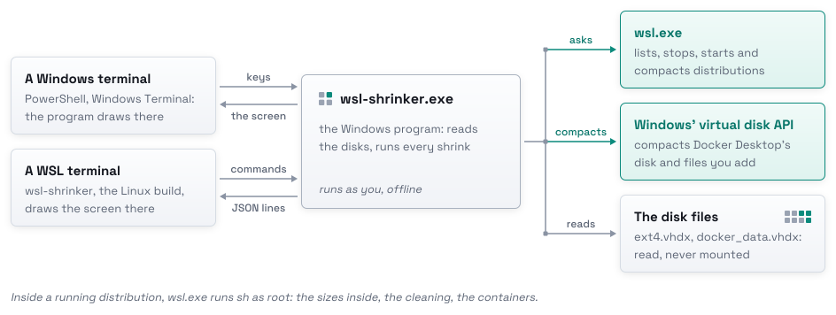

<p align="center">
  <picture>
    <source media="(prefers-color-scheme: dark)" srcset="docs/assets/logo-dark.svg">
    
  </picture>
</p>

<p align="center">
  <b>Give Windows back the space your WSL disks no longer use, and know how much before you start.</b><br>
  A terminal screen and a CLI for every WSL 2 disk on your PC.
</p>

<p align="center">
  <a href="https://github.com/kanggu12/wsl-shrinker/actions/workflows/ci.yml"></a>
  <a href="https://github.com/kanggu12/wsl-shrinker/releases"></a>
  <a href="LICENSE"></a>
  <a href="https://github.com/kanggu12/wsl-shrinker/pkgs/container/wsl-shrinker-demo"></a>
  
</p>

<p align="center">
  <a href="#quick-start">Quick start</a> |
  <a href="#what-it-does">What it does</a> |
  <a href="#how-it-works">How it works</a> |
  <a href="#documentation">Documentation</a> |
  <a href="#contributing">Contributing</a>
</p>

<picture>
  <source media="(prefers-color-scheme: dark)" srcset="docs/assets/demo-dark.gif">
  
</picture>

A WSL 2 distribution keeps its files in a virtual disk, `ext4.vhdx`, that grows but never shrinks on its own. WSL 3.0.1
and later can compact it (`wsl --manage <distro> --compact`). wsl-shrinker adds what that leaves out: how much comes
back, what fills the disk, containers stopped properly first, and a check of the result.

## Quick start

Windows 10 or 11 with WSL 2 ([requirements](docs/setup.md#requirements)), in PowerShell:

```powershell
# 1. Install for this user. It opens setup to choose how it works.
irm https://github.com/kanggu12/wsl-shrinker/releases/latest/download/install.ps1 | iex

# 2. In a new terminal, see every WSL disk and what a shrink would give back. It changes nothing.
wsl-shrinker list

# 3. Open the screen: choose a disk, see what fills it, shrink it. Nothing runs before you confirm.
wsl-shrinker
```

The same `wsl-shrinker` works in a WSL terminal opened after the install. With Scoop:
`scoop install https://github.com/kanggu12/wsl-shrinker/releases/latest/download/wsl-shrinker.json`.

Setup is five quick choices, and your disks stay as they are:

<picture>
  <source media="(prefers-color-scheme: dark)" srcset="docs/assets/setup-dark.png">
  
</picture>

`wsl-shrinker setup` opens it again. From any terminal, `wsl-shrinker shrink NAME` shrinks a disk step by step after
asking first, and `wsl-shrinker inside NAME` lists what can be removed in it. No install yet?
[Try it in a sandbox](docs/setup.md#try-it-in-a-sandbox): the screen on a made-up PC, wherever Docker runs.

## What it does

- **The size after, before anything runs.** It reads the disk's block table and ext4's bitmaps, without mounting it.
- **Only what you choose goes.** Caches, downloads and unused Docker images are listed with their sizes; Docker
  volumes and containers never go.
- **Containers stop properly.** Each gets its own timeout and your pre-stop scripts run; with
  [wsl-spawner](https://github.com/kanggu12/wsl-spawner) installed, the stop goes through it.
- **It checks the result.** The disk is read again after the compaction; one that does not read as before stays
  stopped.
- **A closed window is not a lost run.** The next start finishes a run that was cut off.
- **Light.** One program: no service, no administrator rights, no network.

<p align="center">
  <picture>
    <source media="(prefers-color-scheme: dark)" srcset="docs/assets/steps-dark.svg">
    
  </picture>
  <br>
  <i>A shrink, step by step: check and verify only read, and clean removes only what you chose.</i>
</p>

## How it works

<picture>
  <source media="(prefers-color-scheme: dark)" srcset="docs/assets/pieces-dark.svg">
  
</picture>

`wsl-shrinker.exe` does the work: the disks are Windows' to read and to compact. Inside WSL, `wsl-shrinker` is the
Linux build of the same program, which draws the screen in your terminal and asks the `.exe` for every answer.
[How it works](docs/how-it-works.md) has the estimate and every check of a shrink.

## Documentation

[Setup](docs/setup.md) · [How it works](docs/how-it-works.md) · [Commands](docs/commands.md) ·
[Settings](docs/settings.md) · [Troubleshooting](docs/troubleshooting.md) · [Questions](docs/questions.md) ·
[Internals](docs/internals.md). [The guides' index](docs/README.md) says what each covers.

## Contributing

[CONTRIBUTING.md](.github/CONTRIBUTING.md) has how the pieces fit, how to build and test, and what a change needs.
Problems go to [Issues](https://github.com/kanggu12/wsl-shrinker/issues/new/choose), security problems as
[SECURITY.md](.github/SECURITY.md) says; [CHANGELOG.md](CHANGELOG.md) lists what changed.

## License

MIT ([LICENSE](LICENSE)). The libraries wsl-shrinker is built from, and the font of its logo and figures, are listed
with their licenses in [THIRD_PARTY_NOTICES.md](docs/THIRD_PARTY_NOTICES.md).
