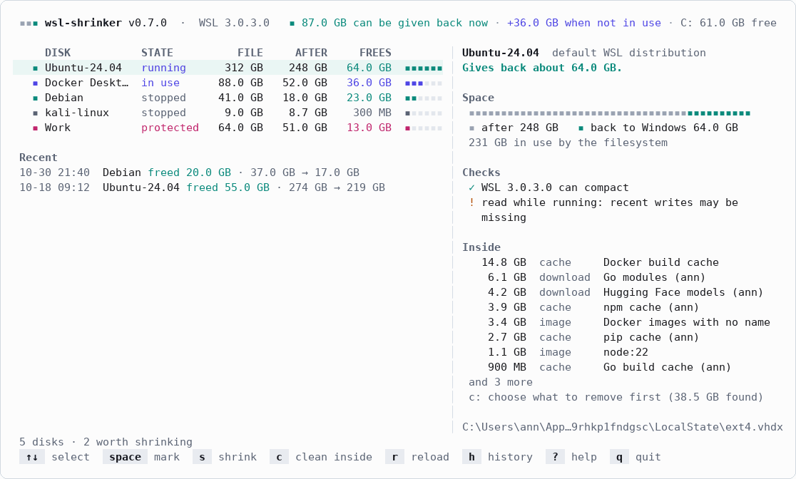
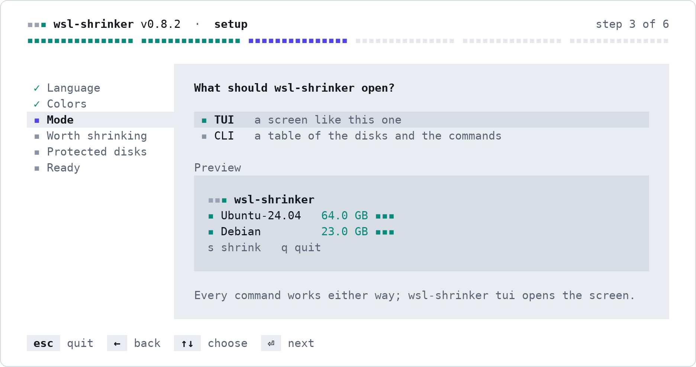
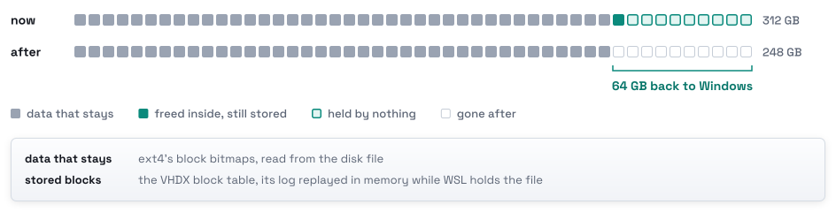
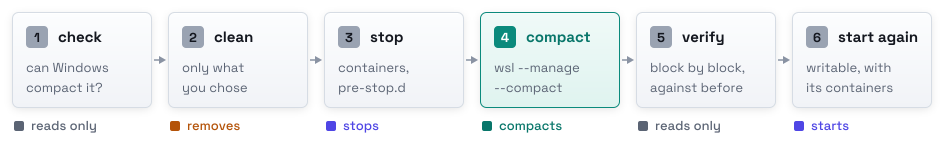
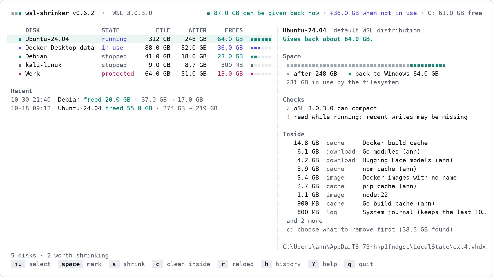
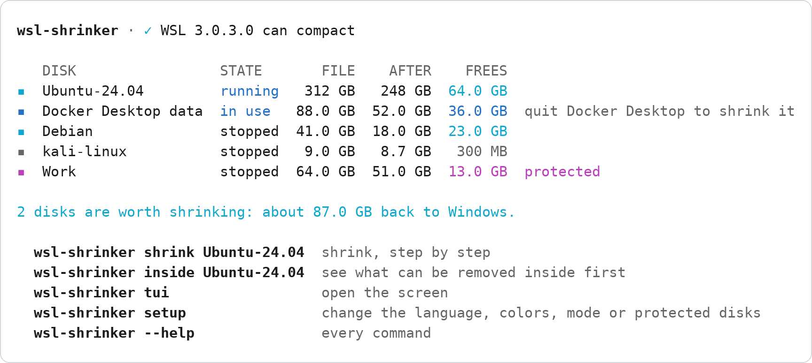

<p align="center">
  <picture>
    <source media="(prefers-color-scheme: dark)" srcset="docs/assets/logo-dark.svg">
    
  </picture>
</p>

<p align="center">
  <b>Give Windows back the space your WSL disks no longer use, and know how much before you start.</b><br>
  A terminal screen and a CLI for every WSL 2 disk on your PC.
</p>

<p align="center">
  <a href="https://github.com/kanggu12/wsl-shrinker/actions/workflows/ci.yml"></a>
  <a href="https://github.com/kanggu12/wsl-shrinker/releases"></a>
  <a href="LICENSE"></a>
  <a href="https://github.com/kanggu12/wsl-shrinker/pkgs/container/wsl-shrinker-demo"></a>
  
</p>

<p align="center">
  <a href="#quick-start">Quick start</a> |
  <a href="#why-wsl-shrinker">Why</a> |
  <a href="#a-shrink-step-by-step">A shrink</a> |
  <a href="#the-screen">The screen</a> |
  <a href="#commands">Commands</a> |
  <a href="docs/README.md">Documentation</a> |
  <a href="#open-source">Open source</a>
</p>

<picture>
  <source media="(prefers-color-scheme: dark)" srcset="docs/assets/demo-dark.gif">
  
</picture>

A WSL 2 distribution keeps its files in a virtual disk, `ext4.vhdx`, that grows but never shrinks on its own. WSL 3.0.1
and later can compact it (`wsl --manage <distro> --compact`). wsl-shrinker adds what that leaves out: how much comes
back, what fills the disk, and containers stopped properly first.

## Quick start

In PowerShell, on Windows 10 or 11 with WSL 2 ([requirements](docs/setup.md#requirements)):

```powershell
# Install for this user; it opens setup to choose how it works.
irm https://github.com/kanggu12/wsl-shrinker/releases/latest/download/install.ps1 | iex

# In a new terminal. It only reads until you confirm a shrink.
wsl-shrinker
```

The same `wsl-shrinker` works in a WSL terminal opened after the install. With Scoop:
`scoop install https://github.com/kanggu12/wsl-shrinker/releases/latest/download/wsl-shrinker.json`.
[Setup](docs/setup.md#install) has every way to install and remove it; to look first,
[try it in a sandbox](#try-it-in-a-sandbox).

The first start opens a short wizard, one choice per page with a preview. `wsl-shrinker setup` opens it again.

<picture>
  <source media="(prefers-color-scheme: dark)" srcset="docs/assets/setup-dark.png">
  
</picture>

## Why wsl-shrinker

- **The size after, before anything runs.** It reads the VHDX block table and ext4's bitmaps without mounting the
  disk. On disks WSL made, the estimate matched the compacted file to the byte.
- **Only what you choose goes.** Caches, downloads, the trash, the system journal and unused Docker images are listed
  with their sizes. Docker volumes and containers are never removed.
- **Containers stop properly.** Each with its own timeout, then your scripts in `/etc/wsl-shrinker/pre-stop.d/`; the
  ones that ran start again afterwards.
- **It checks the result.** The disk is read again after the compaction. One that does not read as before stays
  stopped.
- **A closed window is not a lost run.** A journal lets the next start finish a run that was cut off.
- **Light.** One program: no service, no administrator rights, no network.

## A shrink, step by step

<picture>
  <source media="(prefers-color-scheme: dark)" srcset="docs/assets/estimate-dark.svg">
  
</picture>

A compaction keeps exactly the stored blocks that hold data, so the size after is known before it runs. Docker
Desktop's disk and files from the settings are compacted without a trim: only their blocks of zeros go, and their
estimate counts them that way.

<picture>
  <source media="(prefers-color-scheme: dark)" srcset="docs/assets/steps-dark.svg">
  
</picture>

| Step | What happens |
|:---|:---|
| **Check** | WSL's version, an encrypted file, a fixed-size disk, a disk another program holds, errors the filesystem recorded |
| **Clean** | Only what you chose |
| **Stop** | Containers, each with its own timeout, then your pre-stop scripts |
| **Compact** | WSL's own `wsl --manage --compact`; Windows' virtual disk API for files WSL does not register |
| **Verify** | The disk must read without errors and hold what it held, less what you removed |
| **Start again** | The distribution, writable, with the containers that ran. With no terminal open in it, WSL stops it again about 15 seconds later; the run says so |

A run started inside the distribution it shrinks continues in a new window. [How it works](docs/how-it-works.md) has
every check.

## The screen

<picture>
  <source media="(prefers-color-scheme: dark)" srcset="docs/assets/screenshot-dark.png">
  
</picture>

Every WSL 2 distribution, Docker Desktop's data disk and any VHDX file from the settings: its size now, after a shrink,
and what comes back. Nothing is started to read a disk, and a protected disk is never shrunk.

| Key | Does | Key | Does |
|:---:|:---|:---:|:---|
| <kbd>↑</kbd> <kbd>↓</kbd> | select a disk | <kbd>c</kbd> | choose what to remove inside it |
| <kbd>space</kbd> | mark it, to shrink several in one run | <kbd>r</kbd> | read the disks again |
| <kbd>s</kbd> or <kbd>⏎</kbd> | shrink the marked disks, or the selected one | <kbd>h</kbd> | past runs |
| <kbd>R</kbd> | finish a run that was cut off | <kbd>F</kbd> | forget one that <kbd>R</kbd> could not finish |
| <kbd>?</kbd> | every key and what each color means | <kbd>q</kbd> | quit |

It speaks English and Korean (`--lang`; Windows' language by default). In CLI mode, a bare `wsl-shrinker` prints the
disks and the commands to use instead; `wsl-shrinker tui` opens the screen in either mode.

<picture>
  <source media="(prefers-color-scheme: dark)" srcset="docs/assets/cli-dark.png">
  
</picture>

## Try it in a sandbox

```sh
docker run --rm -it ghcr.io/kanggu12/wsl-shrinker-demo
```

The screen on a made-up PC with five disks, in any terminal with Docker; nothing real is read or changed. Add
`-e WSL_SHRINKER_LANG=ko` before the image name for Korean. Once installed, `wsl-shrinker --demo` opens the same PC.

## Commands

| Command | Does |
|:---|:---|
| `wsl-shrinker` | the screen in TUI mode, the disks and the commands to use in CLI mode |
| `tui` | the screen, in either mode |
| `setup` | the wizard; flags (`--mode cli`, `--protect NAME`, ...) set a choice without it |
| `list [--json]` | every disk and what a shrink gives back |
| `inside DISTRO [--json]` | what can be removed inside a running distribution, with ids |
| `shrink DISK... [--clean DISK=ID,ID] [--yes]` | shrink by name, printing each step |
| `recover [--forget]` | finish a run that was cut off, or close it as it is |
| `history [--json \| --clear]` | past runs, each with its steps, or remove them |
| `doctor` | what a shrink needs on this PC, and what to do about what is missing |
| `config [path\|init]` | where the settings are, or a settings file with every key |
| `uninstall [--purge]` | remove wsl-shrinker from this PC, with the settings and the history if asked |

[Commands](docs/commands.md) has every flag, the `--json` shape and the exit codes.

## Settings

In `%APPDATA%\wsl-shrinker\config.toml`. Setup writes the first three; add `extra_disks` by hand:

```toml
mode = "cli"                          # what a bare wsl-shrinker opens: "tui" or "cli"
min_gain_gb = 5                       # mark a disk worth shrinking from 5 GB back
protect = ["Work"]                    # disks, by name, that are never shrunk
extra_disks = ['D:\VMs\data.vhdx']    # more VHDX files to show and shrink
```

[Settings](docs/settings.md) has every key, and the scripts a distribution runs before it stops.

## How it compares

| | Says what it gives back | Shows what fills it | Stops services first | Checks the result | Screen |
|:---|:---:|:---:|:---:|:---:|:---:|
| **wsl-shrinker** | exact, before | yes | yes | yes | terminal |
| `wsl --manage --compact` (WSL 3.0.1) | no | no | no, stops them as they are | no | none |
| `Optimize-VHD` / `diskpart` scripts | no | no | no | no | none |
| Export-and-import tools | estimate | no | no | no | none |
| WSL managers with a compact button | after | no | no | no | window |

wsl-shrinker runs `wsl --manage --compact` itself, and adds what comes before and after it.

## Questions

**Will it delete my files?** Only the items you choose inside a distribution, right before the compaction. Docker
volumes and containers never.

**Is it safe to close the window during a shrink?** WSL finishes a compaction it started. The next start says what is
left, and `R` or `wsl-shrinker recover` starts the distribution and its containers again. If that start fails, `F` or
`wsl-shrinker recover --forget` closes the run and says how to start them by hand.

**How do I remove it?** `wsl-shrinker uninstall`, in PowerShell or WSL. `--purge` removes the settings and the history
too.

**Why did my terminal close?** Shrinking the distribution your terminal runs in stops it, so the run moves to a new
window first.

**Does it work with WSL 1?** No: a WSL 1 distribution keeps its files on the Windows drive, with no disk file to
shrink, so it is not listed.

**What does it touch?**

<picture>
  <source media="(prefers-color-scheme: dark)" srcset="docs/assets/touches-dark.svg">
  
</picture>

## Documentation

| Guide | What it covers |
|:---|:---|
| [Setup](docs/setup.md) | requirements, every way to install, upgrade and remove; Windows, WSL and PowerShell versions |
| [How it works](docs/how-it-works.md) | finding the disks, the estimate, each step of a shrink and its checks |
| [Commands](docs/commands.md) | every command and flag, the screen's keys, the `--json` shape, the exit codes |
| [Settings](docs/settings.md) | `config.toml`, the pre-stop scripts, the files wsl-shrinker writes |
| [Troubleshooting](docs/troubleshooting.md) | a disk that gives back less than expected, a step that fails, an install that does not |
| [Internals](docs/internals.md) | the layers, what runs where, the decisions, the tests |

## Open source

MIT licensed. The tests build the VHDX files and ext4 filesystems they read and shrink on a fake WSL, so no change
needs your own disks.

- **Report a disk it got wrong** in [Issues](https://github.com/kanggu12/wsl-shrinker/issues/new/choose), with the
  output of `wsl-shrinker doctor` and `wsl-shrinker list --json`, and for a run `wsl-shrinker history --json`.
- **Change the code**: [CONTRIBUTING.md](.github/CONTRIBUTING.md) maps the code and says what a change needs.
- **See what changed** in [CHANGELOG.md](CHANGELOG.md); report security problems as [SECURITY.md](.github/SECURITY.md)
  says.

```sh
git clone https://github.com/kanggu12/wsl-shrinker && cd wsl-shrinker
make check          # gofmt, go vet, staticcheck, shellcheck, the unit tests
make test-windows   # from WSL: every package again as a Windows program
make demo           # the screen on a made-up PC, in a container
```

## License

MIT ([LICENSE](LICENSE)). The libraries wsl-shrinker is built from, and the font of its logo and figures, are listed
with their licenses in [THIRD_PARTY_NOTICES.md](docs/THIRD_PARTY_NOTICES.md).
