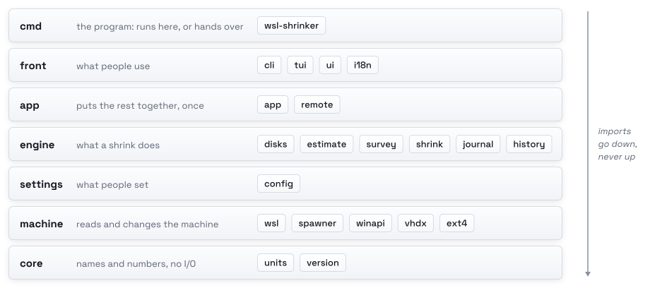

# wsl-shrinker internals

How the code is laid out, what runs where, what it reads and changes, why, and how it is tested. For what a shrink
does from the outside, see [how it works](how-it-works.md).

## Layout

The packages sit in layers, and an import goes down the layers, never up. `internal/layers_test.go` fails on an import
that goes up and on a folder that belongs to no layer; it reads the source with `go/parser`, so it also runs as a
Windows test binary. `internal/version` sits with core, where every layer may reach it, and `internal/testutil` serves
tests only.

<picture>
  <source media="(prefers-color-scheme: dark)" srcset="assets/layers-dark.svg">
  
</picture>

| Layer | Package | What it holds |
|:---|:---|:---|
| cmd | `cmd/wsl-shrinker` | `main`; inside WSL, the launcher that draws the screen there or hands the command line to `wsl-shrinker.exe` |
| front | `cli` | the commands, CLI mode's overview, the look of a mistake |
| | `tui` | the screen, the setup wizard, the made-up PC of `--demo` |
| | `ui` | the colors, the block, fitting text to the cell |
| | `i18n` | every word, in English and Korean |
| app | `app` | puts the rest together for this PC, once: settings, disks, history, the journal |
| | `app/remote` | the screen's backend from inside WSL: `wsl-shrinker.exe` asked through WSL's pipes |
| engine | `disks` | finding every disk and reading its estimate |
| | `estimate` | what a compaction leaves, from the block table and the bitmaps |
| | `survey` | what fills a running distribution, and the one command that removes each item |
| | `shrink` | the steps of a run, `Preflight` (whether a disk can be shrunk now) and how a run left its distribution |
| | `journal`, `history` | the run going on (`run.json`), and past runs |
| settings | `config` | `config.toml`, read whole and written key by key |
| machine | `wsl` | `wsl.exe` and the registry's list of distributions |
| | `winapi` | file attributes, Windows' virtual disk API, the console, a new window |
| | `vhdx`, `ext4` | the disk file's block table with its log replayed, and the filesystem's bitmaps; both only read |
| core | `units`, `version` | sizes as Windows shows them; the build's version |

## What runs where

<picture>
  <source media="(prefers-color-scheme: dark)" srcset="assets/pieces-dark.svg">
  
</picture>

`wsl-shrinker.exe` does the work: the disks are Windows' to read and to compact. In WSL, `wsl-shrinker` is the Linux
build of the same code, and before anything else it decides where to run:

1. Outside WSL, or with `--demo` or `--snapshot`, it runs where it is: the demo needs nothing of Windows.
2. It finds `wsl-shrinker.exe` beside itself or on the PATH and reads the program's header. A build for another
   processor stops here, in the terminal, where Windows would have shown a dialog on the desktop.
3. A screen (TUI mode, or `wsl-shrinker tui`) with a `wsl-shrinker.exe` of its own build runs in the Linux terminal.
   `app/remote` stands in for the engine: it runs `wsl-shrinker.exe list --json`, `inside --json` and `history --json`,
   and the hidden `backend` command (`hello`, `info`, `settings`, `pending`, `shrink`, `reopen`, `crashes`), whose
   `shrink` streams the run's events as JSON lines. `hello` checks the two are the same build first.
4. Anything else, every other command and a `wsl-shrinker.exe` of another build, is handed to `wsl-shrinker.exe` with
   `exec`, with the distribution's name passed through `WSLENV`.

A shrink stops its distribution, and the terminal in it with it. Started from inside the distribution it shrinks, the
run continues in a new window (`start`, the default terminal), already confirmed; the new window leaves a receipt
(`handoff-*`) that the old terminal waits for, so a window that never started is said, not guessed.

## What it reads and what it changes

<picture>
  <source media="(prefers-color-scheme: dark)" srcset="assets/touches-dark.svg">
  
</picture>

A few rules keep that list short, each held in one place:

- **The readers only read.** `machine/vhdx` and `machine/ext4` open files for reading, and refuse what they do not
  fully understand (a checksum that fails, a region marked required that they do not know, a differencing disk)
  rather than guess.
- **Two places build commands.** Every command run inside a distribution comes from a fixed list in `engine/survey`
  (cleaning) or `engine/shrink` (stopping and starting); an id from the command line is looked up again in a fresh look
  inside, so only commands built there run. `TestNoCommandTouchesWhatMustStay` fails if one could remove a volume or a
  container.
- **One rule for "can it be shrunk".** `shrink.Preflight` decides, and the run's check, the screen, `doctor` and
  `shrink` all ask it. A protected disk is refused by the run itself, whatever asked for it.
- **One answer for "how was it left".** The end of `shrink.Run` decides how the distribution was left (`running`,
  `stopped`, `file`, `suspect`, `down`), also after a panic in the run's own code, and the screen, the command line and
  the history say what it says.
- **One run at a time.** `run.json` is created whole, with a hard link, before anything changes; a second run finds it
  and stops. A run cut off leaves it behind, and `recover` reads it.

## Decisions

### Read the disk rather than ask

WSL does not say how much a compaction gives back, and Windows' own tools say it only after. The size after is decided
by two tables wsl-shrinker can read without changing anything: the VHDX block table, which says which 1 MiB blocks the
file stores, and ext4's block bitmaps, which say which hold data. A disk WSL holds is read with its log replayed in
memory, as Windows replays it on open. [How it works](how-it-works.md#the-estimate) has the arithmetic.

### WSL compacts; wsl-shrinker does what is around it

The compaction itself is `wsl --manage <distro> --compact`, which trims the filesystem first and keeps WSL's own state
right. What wsl-shrinker adds is what WSL leaves out: the size before, what fills the disk, stopping containers with
their own timeouts and the person's pre-stop scripts, and reading the disk again afterwards. Only the files WSL does
not register (Docker Desktop's disk, files from the settings) go through Windows' virtual disk API.

### The screen in the terminal it was opened in

A Windows program started from WSL gets a console of its own, with its own keys and colors. Drawing the screen in the
Linux build keeps the person's terminal, tmux and zellij included, while the disks stay Windows' to read: the screen
asks, `wsl-shrinker.exe` answers. Both are one build, checked by `hello`, so the two never disagree on a format.

### No service, no administrator, no network

It runs when started and ends when done. Compacting a distribution is something WSL lets the user do, and nothing it
reads needs more. It sends nothing anywhere: no update check, no telemetry.

### Two modes, one engine

TUI and CLI mode are two fronts on the same engine: every command works in both, and both read `Preflight` and the
run's outcome rather than deciding again.

## Tests

A change comes with a test that fails without it. Almost nothing needs a real disk: the readers are tested on VHDX
files and ext4 filesystems the tests build, the steps of a shrink on a fake WSL, and the screen on the made-up PC.

| Level | Where | What it shows |
|:---|:---|:---|
| Layers and changelog | `internal/layers_test.go`, `internal/changelog_test.go` | no import goes up a layer; the changelog in shape, newest first, the badge naming the newest release |
| Readers | `machine/vhdx`, `machine/ext4` | files the tests build (`mkfs.ext4` for the filesystems), the log replayed, every refusal; fuzzing of both |
| WSL's words | `machine/wsl` | `wsl.exe`'s own output, recorded in UTF-16 and UTF-8, through the parsing |
| A shrink | `engine/shrink` | every step on a fake WSL; `TestRecoveryMatrix`: for every point a run can fail at, on every kind of disk, how the distribution and its containers are left |
| Cleaning | `engine/survey` | the commands built for each item, and none that could remove a volume or a container |
| The screen | `front/tui` | every view at widths from 40 to 200 columns in English and Korean, each line exactly the screen's width; the setup wizard's pages |
| The command line | `front/cli` | both modes, the look of a mistake in a terminal and piped, setup's flags |
| The launcher | `cmd/wsl-shrinker` | where it runs, the processor and Windows build checks, with fake programs and no `cmd.exe` |
| Windows | `scripts/test-windows.sh`, CI | every package again as a Windows program; the screen and setup in a pseudoconsole; on Windows Server 2022 and 2025 and Windows 11 on Arm |
| A real WSL | CI | a throwaway Alpine distribution on Windows Server 2025's WSL 2 with Docker in it, two containers running and one stopped, half a GiB freed inside, estimated, shrunk while it runs and read again, what came back held against the estimate and the containers against what ran; copies of its disk where Docker Desktop keeps its disk, where Docker's settings move it, and from `extra_disks`, compacted through Windows' virtual disk API and held against their estimates; a WSL 1 one on Server 2022's built-in WSL, which must not be listed |
| Installers and packages | CI, release | `install.ps1` in Windows PowerShell 5.1 and PowerShell 7 and on ARM64, installed, run and removed; the Scoop manifest; the demo image |

No test opens a window: `winapi.Reopen` refuses inside a test binary, and the launcher's tests replace what it reaches
Windows through. [Contributing](../.github/CONTRIBUTING.md#run-the-tests) has the commands.

<picture>
  <source media="(prefers-color-scheme: dark)" srcset="assets/release-dark.svg">
  
</picture>

**CI** (`.github/workflows/ci.yml`) runs on every push to `main`, every pull request, and every Monday, so a new Go
patch, runner image or WSL release shows up before a release does. It runs `make check`, fuzzing for a short while and
`govulncheck` for Linux and Windows; builds the release zips and the demo image from the commit, and runs the image;
runs the tests and the program itself on Windows Server 2022 and 2025 and on Windows 11 on Arm, each with the WSL it
has; shrinks a throwaway distribution on Server 2025's WSL 2 for real; and installs the zip it built with `install.ps1`
in Windows PowerShell 5.1 and PowerShell 7 and on ARM64, runs it, and removes it again. Windows 10 has no hosted
runner; it runs the same code as Server 2022.

**A release** is a `vX.Y.Z` tag on a commit whose `CHANGELOG.md` has a `## [X.Y.Z]` section, with the README's badge
naming it. `.github/workflows/release.yml` runs all of CI on the tagged commit, then `scripts/dist.sh` builds the zips,
`checksums.txt` and the Scoop manifest; the zips get build provenance (`gh attestation verify`), and the release is
published with the changelog's section as its notes. The demo image goes to `ghcr.io/kanggu12/wsl-shrinker-demo` for
amd64 and arm64. Last, the installers run against the published release, as people run them.
