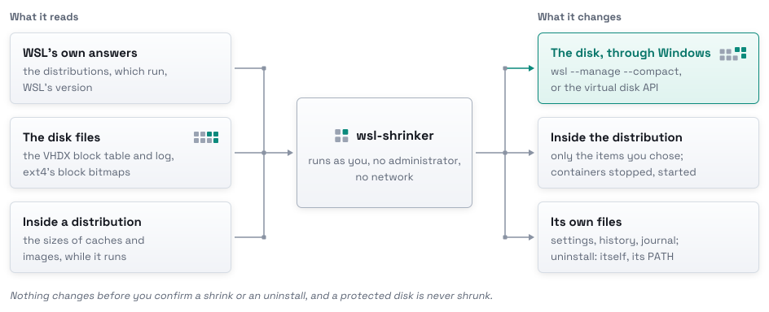

# Questions

## Will it delete my files?

Only the items you choose inside a distribution, right before the compaction. Docker volumes and containers never.
[How it works](how-it-works.md#a-shrink) has the one command each item is removed with.

## Is it safe to close the window during a shrink?

WSL finishes a compaction it started. The next start says what is left, and `R` or `wsl-shrinker recover` starts the
distribution and its containers again. If that start fails, `F` or `wsl-shrinker recover --forget` closes the run and
says how to start them by hand ([Troubleshooting](troubleshooting.md#the-window-closed-during-a-run)).

## How do I remove it?

`wsl-shrinker uninstall`, in PowerShell or WSL. `--purge` removes the settings and the history too
([Setup](setup.md#upgrade-and-remove)).

## Why did my terminal close?

Shrinking the distribution your terminal runs in stops it, so the run moves to a new window first
([Troubleshooting](troubleshooting.md#a-new-window-opened)).

## Does it work with WSL 1?

No: a WSL 1 distribution keeps its files on the Windows drive, with no disk file to shrink, so it is not listed
([Setup](setup.md#wsl) has what each WSL can do).

## What does it touch?

<picture>
  <source media="(prefers-color-scheme: dark)" srcset="assets/touches-dark.svg">
  
</picture>

[Internals](internals.md#what-it-reads-and-what-it-changes) has the rules that keep that list short, and
[Settings](settings.md#files-wsl-shrinker-writes) the files it writes.
